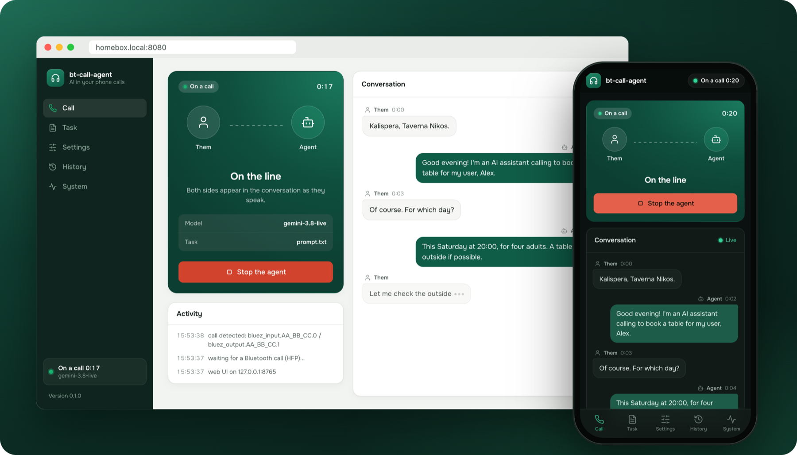
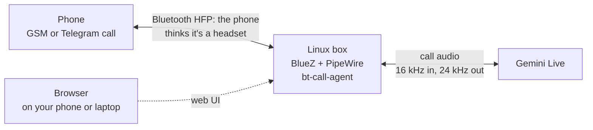

<div align="center">

# bt-call-agent

**An AI agent that talks in your phone calls.**

Your Linux box pretends to be a Bluetooth headset. The phone sends the call to it
like it would to any earbuds, and the agent does the talking through Gemini Live.<br>
No root, no Twilio, no hacking Android.




</div>

## What you get

- **The agent handles the call.** Give it a task, like booking a table for four on
  Saturday. It greets the other side, talks, listens, lets itself be interrupted, and
  speaks their language.
- **It works with the calls you already make.** Anything the phone routes to a
  Bluetooth headset: regular calls, Telegram, WhatsApp, Signal. So far it's tested
  with Telegram.
- **You stay in control.** Follow the conversation live from your phone or laptop,
  change the task between calls, or stop the agent mid-call and take over yourself.
  Every call is saved as a transcript.

## How it works



## Quick start

```bash
pipx install git+https://github.com/romirom11/bt-call-agent
bt-call-agent setup enable              # headset mode, asks for sudo; undo with `setup disable`
bt-call-agent pair                      # pair the phone, then turn on "Phone calls" for it
bt-call-agent run --web 0.0.0.0:8080    # prints a link to the web UI
```

Open the printed link on your phone, add your
[Gemini API key](https://aistudio.google.com/apikey) in Settings, write the task, and
make a call with the phone's audio on the Bluetooth device. The agent takes it from
there. [Setup](#setup) below goes through each step.

## Status

Early prototype (v0.1). Expect rough edges. Tested with a Pixel 7 Pro over
Telegram calls on:

| Distro | BlueZ | PipeWire | WirePlumber | Adapter |
|---|---|---|---|---|
| Arch Linux (desktop) | 5.87 | 1.6.9 | 0.5.18 | Realtek USB |
| Ubuntu 26.04 (headless server) | 5.85 | 1.6.2 | 0.5.13 | Realtek RTL8821C USB |

What works:
- the phone sees the machine as a headset (HFP Hands-Free, wide-band mSBC)
- two-way audio, the agent speaks first, barge-in (interrupt the agent mid-sentence)
- live transcript of both sides, saved per call
- surviving Android's mid-call audio re-routing

Not yet:
- dialing a number from the agent (HFP supports `ATD<number>;` — on the roadmap)
- tools (calendar, booking APIs…) for the agent

## Requirements

- Linux with **BlueZ ≥ 5.6x**, **PipeWire ≥ 1.0** with **WirePlumber 0.5** and its
  BlueZ plugin (Arch: `bluez bluez-utils pipewire wireplumber pipewire-audio`;
  Debian/Ubuntu: `bluez pipewire wireplumber libspa-0.2-bluetooth`)
- a Bluetooth adapter whose SCO (call) audio goes over HCI. Tested with a Realtek
  USB adapter. Raspberry Pi's built-in one routes SCO to PCM pins by default, so
  use a USB dongle there.
- Python ≥ 3.10
- a [Gemini API key](https://aistudio.google.com/apikey)
- a phone, within Bluetooth range

## Install

```bash
pipx install git+https://github.com/romirom11/bt-call-agent
# or with uv:
uv tool install git+https://github.com/romirom11/bt-call-agent
```

On Debian/Ubuntu, pipx and `python3 -m venv` need the `python3-venv` package
(`sudo apt install pipx python3-venv`).

## Setup

**1. Put the machine into headset mode** (asks for sudo):

```bash
bt-call-agent setup enable
```

This changes three things, all reverted by `bt-call-agent setup disable`:

| What | Why |
|---|---|
| WirePlumber `bluez5.roles = [ hfp_hf a2dp_sink ]` | advertise the *headset* side of HFP instead of the *phone* side |
| `/etc/bluetooth/main.conf`: `Class = 0x240404` | look like a headset (Audio/Video → Wearable Headset), not a computer |
| `bluetoothd -P hostname` (systemd drop-in) | BlueZ's hostname plugin would override the class with "Computer" again |

On a **headless** machine (no local login), `setup enable` also turns off
WirePlumber's BlueZ *seat monitoring*. Otherwise WirePlumber only starts Bluetooth
audio for an active local seat, and no headset profile ever appears.

> While headset mode is on, this machine can't play its own audio to Bluetooth
> headphones. That's why it's a toggle.

**2. Pair the phone:**

```bash
bt-call-agent pair
```

On the phone: Bluetooth → pair new device → pick this machine. Then open the
device's settings on the phone and make sure **Phone calls** is enabled.

**3. API key:**

```bash
mkdir -p ~/.config/bt-call-agent
install -m 600 /dev/stdin ~/.config/bt-call-agent/key <<< "AIza..."
# or: export GEMINI_API_KEY=AIza...
```

(or paste it into the [web UI](#web-ui)'s Settings once the agent runs with `--web`).

**4. Check everything:**

```bash
bt-call-agent doctor
```

## Run

```bash
bt-call-agent run
```

It waits for a call. Make or answer a call on the phone, with audio routed to
the Bluetooth device, and the agent takes over. It greets first once the other
side picks up (or after 6 s), and answers whenever the other side speaks first.

```
16:19:45 call detected: bluez_input.AA_BB_…0 / bluez_output.AA_BB_…1
16:19:46 Gemini Live connected (gemini-3.8-live)
16:19:51 (greeting)
16:19:57 🤖 agent: Hello, this is an AI assistant calling on behalf of Alex…
16:20:02 👤 them: Hi, how can I help?
```

Transcripts go to `~/.local/state/bt-call-agent/transcripts/`.

Useful options:

| Option | |
|---|---|
| `--web` | also serve the [web UI](#web-ui) |
| `--prompt FILE` | what the agent should do (see [the examples](src/bt_call_agent/data/prompts/)) |
| `--voice Kore` | a prebuilt Gemini voice |
| `--no-greet` | wait for the other side to speak first |
| `--out-volume 0.5` | agent loudness into the call (lower if it distorts) |
| `--model …` | default `gemini-3.8-live` |

Voice, language, greeting, loudness and model can also live in
`~/.config/bt-call-agent/config.json` (the web UI writes it). A flag given on the
command line wins over the file. Both are read again before every call, so you don't
need to restart the agent.

### Web UI

```bash
bt-call-agent run --web                 # http://127.0.0.1:8080, this machine only
bt-call-agent run --web 0.0.0.0:8080    # reachable from your LAN, e.g. from the phone
```

It shows the call live (both sides of the conversation, as they speak), and lets you:

- change the agent's task (the prompt) and keep reusable prompts
- set the voice, language, greeting, loudness and model
- stop the agent mid-call: the call stays up and you can take it over on the phone
- read, download and delete past transcripts
- run the `doctor` checks, pair a phone, and save the Gemini API key

Changes apply from the next call. Switching headset mode on and off needs sudo, so
that stays on the command line.

The UI needs an access token: the agent prints the link with it when it starts, and
`bt-call-agent web-url` prints it again (the token is in
`~/.config/bt-call-agent/web-token`; delete the file to get a new one). Opening the
link once signs that browser in. The server speaks plain HTTP, so on anything other
than your own trusted network, reach it through SSH (`ssh -L 8080:127.0.0.1:8080
box`) or a VPN like Tailscale instead of opening the port.

### Prompts

The prompt decides the agent's task **and its language**. Default lookup order:
`--prompt` → `~/.config/bt-call-agent/prompt.txt` → the bundled test prompt.
Examples (also offered in the web UI):

- [`restaurant-booking.txt`](src/bt_call_agent/data/prompts/restaurant-booking.txt) — book a table, in the restaurant's language
- [`test-call-uk.txt`](src/bt_call_agent/data/prompts/test-call-uk.txt) — Ukrainian test call

### As a service

```bash
bt-call-agent install-service -- --web
systemctl --user enable --now bt-call-agent
journalctl --user -u bt-call-agent -f
bt-call-agent web-url                   # the web UI link
```

## Troubleshooting

**Phone shows the machine as a computer / no "Phone calls" toggle.**
Run `bt-call-agent doctor`. The class must be `0x…0404`. On the phone, *forget*
the device and pair again: phones cache the old class.

**`doctor`: "no Bluetooth audio profiles registered at all".** WirePlumber's
BlueZ monitor isn't running, typically on a headless box (see Setup). Re-run
`bt-call-agent setup enable`, or force it with `BT_CALL_AGENT_HEADLESS=1`.

**Phone says "can't communicate with …".** Forget the device on the phone,
toggle the phone's Bluetooth, pair again. `sudo btmon` shows whether the phone
even reaches the machine.

**The call is detected but the agent goes silent after a second.** Android
re-routes call audio when the other side answers, and PipeWire recreates the
call nodes. The bridge reconnects automatically. If you see it give up
(`call audio gone`), raise `GRACE_S` in `bridge.py`.

**Crackling.** Usually buffer underruns or clipping: try `--out-volume 0.5`.
Check `journalctl -k | grep SCO` for radio-level errors: Wi-Fi on 2.4 GHz and
Bluetooth share the band, and a USB dongle on an extension cable helps.

**Revert everything:** `bt-call-agent setup disable`.

## Be a good citizen

- **Disclose that it's an AI.** The bundled prompts make the agent say so at the
  start of the call. In the EU, AI systems talking to people must make that clear
  (AI Act transparency rules), and it's simply fair.
- **Recording.** Transcripts are recordings of a conversation. Check the consent
  rules where you and the other side are.
- Don't use it for spam, robocalls or impersonation.

## How it works, in more detail

- **HFP roles.** A phone is the *Audio Gateway*; headsets are the *Hands-Free*
  unit. BlueZ + PipeWire can play either; we pick Hands-Free.
- **Audio.** The phone sends call audio over SCO (mSBC, 16 kHz). PipeWire exposes
  it as `bluez_input.<mac>` / `bluez_output.<mac>` nodes, only while a call is up.
- **Bridge.** `pw-record` streams 16 kHz PCM to the Gemini Live websocket.
  Gemini's 24 kHz replies go through a small jitter buffer into `pw-play`.
  Gemini does voice activity detection, interruptions and transcription.

## License

MIT
